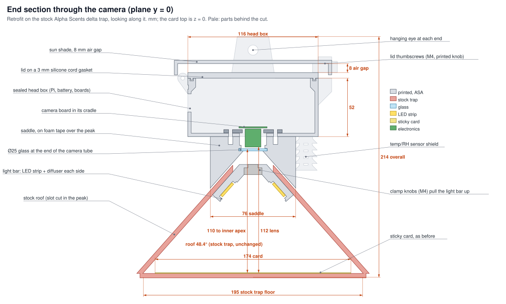
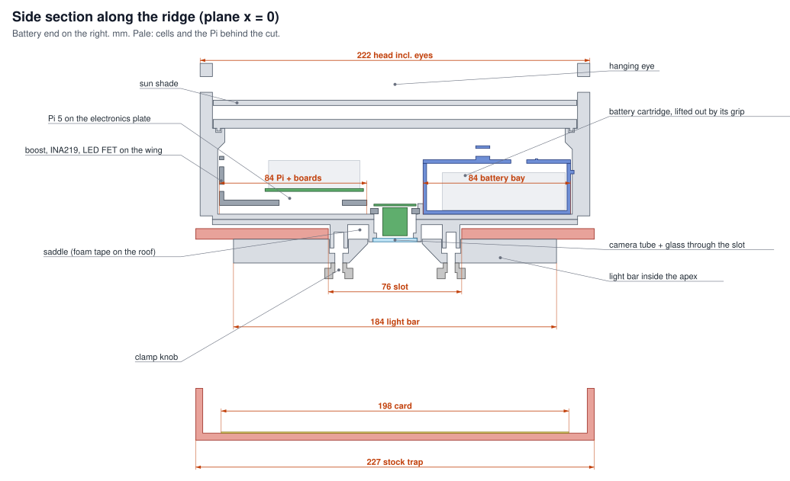
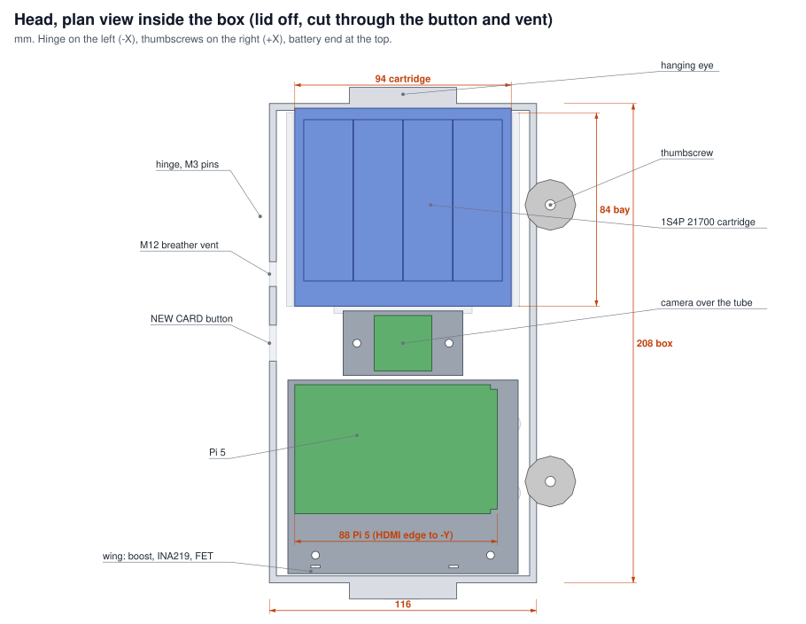
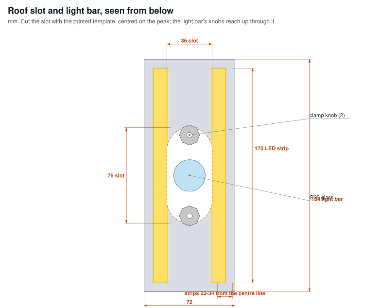

# Camera head for a stock delta trap (Pi 5 build)

A weatherproof head that retrofits onto the farmer's existing Alpha Scents red delta trap
([TRAP.md](TRAP.md)). It holds the Pi 5, the camera, the LEDs and a swappable battery, and the
trap itself stays as it is apart from one slot cut in the roof peak.

Status (2026-10-14): **designed, not printed or tested.** The model is
[scad/trap_housing.scad](scad/trap_housing.scad). Every part renders and exports as a closed
solid, and the drawings below are cut from that model. The parts have not been sliced or printed,
and no fit has been checked against real hardware. Measure the items under
["Measure before printing"](#measure-before-printing) first.



## How it works

- **The trap is unchanged inside.** The 195 mm floor, the 110 mm apex, the 48.4° roof and the open
  ends all stay as they are, so catches remain comparable with ordinary traps and the NEWA
  thresholds still apply. The extra parts inside are a light bar about 14 mm deep at the apex and
  a pair of hand knobs.
- **One slot in the roof.** It is 36 × 76 mm, centred on the peak, and marked with the printed
  template. The saddle sits over the slot on foam tape. The camera tube and the two clamp bosses
  pass down through it.
- **The roof is clamped between two parts.** The saddle sits on the outside of the roof and the
  light bar on the inside. Two M4 knobs pull the light bar up by hand, so no tools are needed.
  This fixes the camera to the roof without screw holes in the trap.
- **The trap hangs from the head.** There is an eye at each end of the head box. Hang it from a
  short bridle (two cords meeting at a carabiner), which stops the trap spinning in the wind.
  Leave the trap's own wire hanger off, because the head is now what holds the trap.
- **The camera looks down through glass.** The lens sits 112 mm above the card, behind a 25 mm
  glass disc at the end of the camera tube. CAMERAS.md measured 15.3 px/mm at about 110 mm; at
  112 mm the estimate is about 15 px/mm.
- **Lighting comes from beside the camera.** Two 170 mm COB LED strips sit behind opal diffusers
  on the light bar's two underside faces. Bench photos on 2026-10-06 showed that light from beside
  the camera gives short shadows ([CAMERAS.md](CAMERAS.md)).
- **The electronics are sealed, with two roofs above them.** The ASA box has a silicone-cord
  gasket under the lid, and a shade sits 8 mm above the lid. Air moves through that gap, and the
  shade keeps direct sun and rain off the lid.



## What the farmer does

| When | What | Time |
|---|---|---|
| Once per trap per season | Lay the template on the roof peak and cut the slot with a utility knife. Set the head on the peak, push the light bar up inside, and turn the two knobs until they are snug. Hang the head by its bridle | ~5 min |
| Each card change (≤ 28 days) | Change the card as usual: slide the old one out of the end and the new one in, header end towards the lure. Wipe the glass with a microfiber cloth. Press **NEW CARD** on the side of the head | 2 min |
| Each card change | Undo the two thumbscrews and lift the lid. Lift the battery cartridge out by its grip, unplug the XT30, plug in a charged cartridge, then close the lid | 1 min |
| At home | Charge the cartridge from any USB-C phone charger. The 4-LED gauge on the lid shows its charge | overnight |

The **NEW CARD** button is wired to the Pi 5's power-button pads (J2). Pressing it while the Pi is
off counts as a new liner ([docs/bring-up.md](../docs/bring-up.md)). A battery swap looks like a
button press too, which is why the server checks the photo before starting a new liner.
Swapping the battery and the card on the same visit, as in the table, keeps that check simple.

## Battery: 1S4P 21700 cartridge, about 72 Wh

| Option | Energy | Mass | Verdict |
|---|---|---|---|
| **4 × 21700, 5 Ah (Samsung 50S/50E, Molicel P45B 4.5 Ah)** | ~72 Wh (65 usable) | ~280 g of cells | **Chosen.** Lasts one 28-day card interval at the estimated 1.5–2 Wh a day ([docs/wiring.md](../docs/wiring.md)), with margin. Lays flat in 94 × 84 × 31 mm |
| 6 × 18650, 3.5 Ah | ~75 Wh | ~290 g | Same energy, longer and narrower; does not fit beside the camera |
| 2 × 32700 LiFePO4 | ~38 Wh | ~290 g | Safer chemistry but half the energy: about 19 days |
| Power-tool pack (Ryobi 18 V 4 Ah) + buck converter | ~72 Wh | ~600 g | Farmers already own chargers and it is rugged, but it is twice the weight, ties you to one brand, and needs an adapter |
| USB power bank | – | – | No: they switch off when the Pi does, and do not switch back on ([docs/wiring.md](../docs/wiring.md)) |

The cartridge is a printed tray holding:
- a spot-welded 1S4P pack (or one bought ready-made with nickel strip);
- a 1S protection board rated ≥ 10 A;
- a USB-C 3 A **4.2 V** charger board (IP2312; some boards are sold as 4.35 V, so check);
- a 4-LED level gauge under the window in the lid;
- an XT30 lead (keyed, so it cannot go in backwards) to the fuse and INA219 in the head.

The farmer never handles loose cells. The cells are charged only indoors, so no below-0 °C charge
cut-off is needed. If the trap later gets a solar panel (Option A in wiring.md), the CN3791 board
can charge this same 1S pack.

## Components and their sizes

| Part | Size used in the model | Source |
|---|---|---|
| Raspberry Pi 5 | 85 × 56 mm, 4 × Ø2.7 mm holes on 58 × 49 mm, 3.5 mm from the edges. USB-C at 11.2 mm along the long edge; Ethernet/USB stack about 16 mm tall and 3 mm past the board edge | [Pi 5 mechanical drawing](https://datasheets.raspberrypi.com/rpi5/raspberry-pi-5-mechanical-drawing.pdf) |
| Camera (UC-572 board, taken to be the Arducam B0392) | 25 × 24 mm board, M2 holes on 21 × 12.5 mm, M12 lens (2.5 mm, 155° horizontal, f/2.8) | [B0392 manual](https://www.welectron.com/mediafiles/productimg/arducam/Amazon/B0392_Manual.pdf); check the board against it |
| 21700 cell | Ø21.3–21.6 × 70.0–70.6 mm, ~70 g | Molicel P45B and Samsung 50S datasheets (via [NKON](https://www.nkon.nl/en/rechargeable/samsung-inr21700-50s-5000mah-35a.html)) |
| 5 V boost converter | Pololu U3V70F5: 15.2 × 40.6 × 4.6 mm, 2.9 V minimum input | [Pololu 2891](https://www.pololu.com/product/2891). Measure its no-load current (wiring.md) |
| USB-C 1S charger board | ~15 × 30 mm | Retail listings; varies by seller |
| LED strips | 5 V COB, 8 mm wide, ~4000 K, CRI ≥ 90, 2 × 170 mm (~3 W, ~0.6 A together) | Any 5 V COB strip; the 12 V strips in wiring.md need the 12 V build |
| Diffuser | 1 mm opal PC/acrylic strip, 10.4 mm wide, or two layers of natural PETG | Cut from an LED channel kit |
| Glass window | Ø25 × 2 mm (flashlight replacement lens) | – |
| Breather vent | M12 × 1.5 screw-in ePTFE membrane vent | – |
| NEW CARD button | 16 mm IP67 momentary pushbutton | – |
| Gasket | 3 mm solid silicone cord, ~0.65 m | – |
| Foam | 1.5 mm closed-cell foam tape, on the saddle and the light bar | – |
| Fasteners | Stainless M3 (countersunk M3 × 10, M3 × 35 hinge pins), M4 × 25 (lid), M4 × 20 (clamp). Brass heat-set inserts M3 × 5.7 and M4 × 8.1 | – |
| Camera cable | Pi 5 22-to-15-pin, **200 mm** | – |
| SHT45, INA219, MOSFET | As in [docs/wiring.md](../docs/wiring.md) | – |

## Printed parts

Material: **ASA** for everything outdoors. It is UV-stable and does not soften below about 95 °C;
PLA sags in summer sun and PETG yellows. The X1C's enclosure handles ASA well. Print in white, and
use natural PETG only for the diffusers. Use 3 walls and 15 % gyroid infill, plus 5 walls on the
head box and lid so they stay watertight. The masses below are estimated from solid volume at
about 45 % fill; they are not from a slicer.

| Part | Size (mm) | ~g | Print |
|---|---|---|---|
| `head_box` | 137 × 222 × 89 | 115 | Floor down |
| `head_lid` | 137 × 207 × 10 | 60 | Top face down |
| `sun_shade` | 140 × 207 × 13 | 45 | Top face down |
| `saddle` | 76 × 208 × 46 | 155 (less with sparse infill) | Flat top face down |
| `light_bar` | 72 × 184 × 47 | 65 | On one end, chevron upright |
| `camera_cradle` | 52 × 28 × 5 | 2 | Flat |
| `electronics_plate` | 100 × 84 × 28 | 13 | Plate down |
| `battery_cartridge`, `battery_lid` | 94 × 86 × 29, 94 × 88 × 18 | 28 | Floor down, top down |
| `sht_shield` | 20 × 42 × 30 | 2 | Flange down |
| `knob` ×2, `clamp_knob` ×2 | Ø22, Ø16 | 6 | Flat |
| `card_guide` (optional) | 184 × 204 × 3 | 3 | Flat; tape it to the trap floor with VHB |
| `lure_clip` (optional) | 20 × 29 × 19 | 1 | On its side |
| `hole_template` | 90 × 110 × 54 | 11 | Upside down |

Export all of them, plus preview renders, with:

```bash
hardware/scad/export_housing.sh
```

The script writes the STLs and renders to `hardware/print/housing/`, which git ignores. Regenerate
the drawings with `python hardware/housing_drawings.py`. Both need OpenSCAD 2025 or newer: the
Homebrew `openscad` cask is disabled (it fails Gatekeeper), so use `brew install --cask openscad@snapshot`.

The whole unit is about **0.9–1 kg**: roughly 0.5 kg of ASA, 0.28 kg of cells, and about 0.15 kg
of electronics and hardware. Overall it measures 140 × 222 mm, and from the trap floor to the
eyes it is 214 mm tall.



## Weather

| Threat | Measure |
|---|---|
| Rain | The sun shade and its drip edges are the first roof. The lid's tongue presses a silicone cord in the box rim. The saddle is bedded on RTV over the box floor, the glass is glued into the tube, and the wire passages are potted with RTV. The button is IP67 |
| Condensation, lens fog | The ePTFE vent equalises pressure without letting water in. Tape a 10 g silica gel sachet inside the lid and change it with the battery. The air volume around the glass is small |
| Sun and heat | White ASA, an 8 mm ventilated air gap under the shade, and the Pi is off between photos. Li-ion stays below 60 °C if the head is not in full sun all afternoon. The SHT45 sits in a louvred shield under the overhang, shaded and in moving air |
| Wind | The roof is clamped between saddle and light bar along 184 mm of ridge. The bridle hangs from two points so the trap cannot spin. The centre of mass is within about 10 mm of the middle |
| Cold | Cells are charged indoors only. ASA and silicone stay flexible below 0 °C |
| UV | ASA throughout; no PLA or PETG on the outside |
| Insects, spiders, earwigs | The electronics are sealed, with no open vents. Wipe the glass at each card change |
| Handling, drops | 3 mm walls, heat-set brass inserts rather than threads cut in plastic, and nothing fragile on the outside |

## Ideas taken from other traps

- **Sticky Pi** (Geissmann et al. 2022, [PLOS Biology](https://pmc.ncbi.nlm.nih.gov/articles/PMC9262196/)):
  the battery is a separate, keyed, swappable pack, and their 5 Ah pack lasted about 10 days at
  3 photos an hour. Sticky Pi also uses a removable card holder, so every card lands in the same
  place; that is the reason for the card guide.
- **iMETOS iSCOUT** ([manual](https://metos.global/wp-content/uploads/2025/05/iSCOUT-maintenance-manual_2025.pdf)):
  take at least one photo per night under its own light, which gives the most even lighting.
  Its makers also say to wipe the lens with a microfiber cloth and to replace sticky plates when
  they are dirty. The iSCOUT housing is 20 × 15.5 × 17 cm, about the size of this head.
- **Semios and FMC** camera traps, described in a
  [Perennia review](https://www.perennia.ca/wp-content/uploads/2025/08/Smart-Pest-Traps-Ag-Tech-Blog-Post-5.pdf):
  both put the camera on top of an ordinary red or delta trap. This retrofit follows the same
  idea.
- **Polarisers against glare**, from a pest-monitor patent: a polariser on the camera plus a
  diffuser on the light. Glue on a sticky card is glossy, and the bench photos showed a blown-out
  hot spot. Worth a bench test: put polariser film over both diffusers and a crossed disc over the
  glass. It costs about 1.5 stops of exposure.
- **Not yet:** Trapview's self-cleaning foil roll, which advances the sticky surface automatically.
  It removes the card change completely, but it is a mechanism project of its own.



## Measure before printing

1. **Roof wall thickness** (`roof_t`, 4 mm assumed) and the **outside peak angle** of a real trap.
   The saddle and the light bar are cut to fit them exactly.
2. **Lens front to the underside of the camera board** (`lens_len`, 17 mm assumed), with the lens
   focused at 11 cm. Also measure where the lens centre sits relative to the M2 hole pattern
   (`cam_lens_off`).
3. **Lens height.** The model puts the lens 112 mm above the card. Confirm all four card corners
   are in frame on a mock-up before committing; [mockup_template.py](mockup_template.py) checks the
   field of view.
4. **Tolerances.** Print a short test length (10 mm) of the saddle and the light bar and try them
   on a trap first. Change `fit` and `gasket_t` if they are too tight or too loose.

After the camera is mounted, redo the white-card calibration (`sentinel-flatfield`), because the
light, the position and the shadows have all changed ([CAMERAS.md](CAMERAS.md)).

## Not done yet

- No part has been printed or sliced. The Bambu Studio command-line slicer crashed while loading
  the X1C profile, so slice in the app.
- The Pi 5 wing layout (boost, INA219, MOSFET) uses zip ties and foam tape, not screw holes,
  because the boards differ by seller.
- The cartridge's lid hooks and its BMS and charger board pockets are sized from retail listings.
- Whether the light bar's two strips light the card evenly enough has not been tested. Hold two
  strips at this position over the bench trap before printing.
